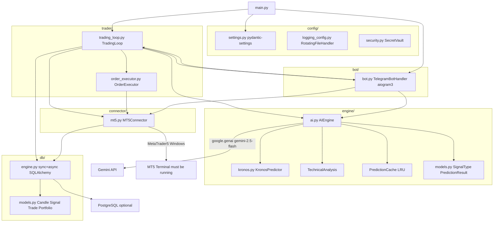

# MT5 Trading Bot "Kron" — Project Knowledge Graph

> For AI assistants. Exact architecture, data flows, module state.

---

## 1. Entry Point & CLI

- **main.py** → `asyncio.run(main())`
  - `--demo`: MT5_DEMO_MODE=True, AMarkets Demo #7872510, orders simulated
  - `--bot`: Telegram bot runs alongside trading loop
  - `-s/--symbol`: override DEFAULT_SYMBOL (default: XAUUSD)
  - `--analyze <SYMBOL>`: one-shot analysis, no trading loop

---

## 2. High-Level Architecture



---

## 3. Trading Cycle Sequence

```mermaid
sequenceDiagram
    participant Loop as TradingLoop
    participant MT5 as MT5Connector
    participant AI as AIEngine
    participant Kronos as KronosPredictor
    participant Gemini as Gemini API
    participant Exec as OrderExecutor
    participant DB as PostgreSQL
    participant TG as TelegramBot

    Loop->>DB: init_db() + health_check()
    Loop->>MT5: connect() demo=AMarkets-Demo#7872510 real=XM#401397663

    loop every ANALYSIS_INTERVAL_MIN (default 15min)
        Loop->>MT5: get_candles(XAUUSD, H1, 300)
        MT5-->>Loop: DataFrame 300 OHLCV candles
        Loop->>MT5: save_candles_to_db() if DB available
        Loop->>AI: analyze(candles_df, symbol)
        AI->>AI: TechnicalAnalysis RSI MACD BB ATR Stoch
        AI->>Kronos: predict() K-line pattern + momentum
        AI->>Gemini: generate_content() LLM validation
        AI-->>Loop: PredictionResult(signal, confidence, SL, TP)
        Note over AI: Tech 50% + Kronos 25% + Gemini 25%
        Note over AI: HOLD if confidence < 0.65

        alt signal.is_actionable
            Loop->>Exec: plan_order(signal, symbol)
            Exec->>Exec: volume=1pct_bal/SL rate_limit<=3/min
            Exec->>MT5: send_market_order() or demo sim
            Loop->>DB: _save_trade()
            Loop->>TG: send_notification()
        else HOLD
            Loop->>Loop: waiting next cycle
        end

        Loop->>DB: _save_signal() + _save_portfolio_snapshot()
    end
```

---

## 4. Module Reference

### 4.1 config/settings.py - Settings(BaseSettings)

Key fields:
- MT5: MT5_LOGIN/PASSWORD/SERVER (real XM #401397663)
- MT5: MT5_DEMO_LOGIN/PASSWORD/SERVER (AMarkets Demo #7872510)
- MT5_DEMO_MODE: bool (True with --demo flag)
- AI: GEMINI_API_KEY, GEMINI_MODEL="gemini-2.5-flash"
- AI: USE_KRONOS_LOCAL=True, USE_GEMINI_FALLBACK=True
- Trading: DEFAULT_SYMBOL="XAUUSD", CONFIDENCE_THRESHOLD=0.65
- Risk: RISK_PER_TRADE_PCT=1.0, DEFAULT_SL_PIPS=50, DEFAULT_TP_PIPS=100
- Limits: MAX_POSITIONS=3, MAX_ORDERS_PER_MIN=3
- Cache: PREDICTION_CACHE_TTL_SEC=300, PREDICTION_CACHE_MAX=20

config/__init__.py: lazy __getattr__ — no crash if pydantic-settings missing

### 4.2 connector/mt5.py - MT5Connector

Methods:
- connect(): picks credentials by MT5_DEMO_MODE -> mt5.initialize() -> mt5.login()
- disconnect(): mt5.shutdown()
- get_candles(symbol, tf, count): copy_rates_from_pos() -> DataFrame time/open/high/low/close/volume
- save_candles_to_db(df, symbol, tf): INSERT ON CONFLICT DO UPDATE (psycopg2). Graceful if no DB
- get_account_info(): dict. free_margin = info.margin_free (NOT free_margin!)
- send_market_order(): DEMO_MODE -> {"demo": True}. Real -> mt5.order_send()
- Singleton: get_mt5()
- WARNING: MT5 Terminal must be running on Windows BEFORE starting bot. Otherwise: IPC send failed (-10001)

### 4.3 engine/models.py

- SignalType: Enum BUY | SELL | HOLD
- PredictionResult: signal, confidence, reason, stop_loss, take_profit
  - .is_actionable = confidence >= CONFIDENCE_THRESHOLD AND signal != HOLD
- TechnicalIndicators: sma_20/50/200, ema_12/26, rsi, macd, bb, atr, stoch, volume_ratio
- CandleData: OHLCV dataclass

### 4.4 engine/kronos.py - KronosPredictor

- KronosFeatures: body_pct, upper/lower_wick, returns[], volume_z, volatility
- KronosPredictor.predict(df) -> PredictionResult:
  1. Multi-scale momentum (5/10/20 candles)
  2. Shadow analysis (pin bars, hammers)
  3. Volume spikes (z-score > 1.5)
  4. Internal RSI calculation
  5. Dynamic SL/TP via ATR
  6. Confidence score [0.0..1.0]
- Supports checkpoint: shiyu-coder/Kronos (HuggingFace)
- Singleton: get_kronos_predictor()

### 4.5 engine/ai.py - AIEngine

- TechnicalAnalysis.compute(df) -> TechnicalIndicators: SMA/EMA/RSI/MACD/BB/ATR/Stoch/VolumeRatio
- PredictionCache (LRU): TTL=300s, Max=20, Key=(symbol, candle_hash)
- AIEngine.analyze():
  1. TechnicalAnalysis.compute()
  2. _technical_analysis_only() — 10-factor weighted voting
  3. _predict_with_kronos()
  4. _analyze_with_gemini() — google.genai SDK. ImportError -> None (no crash)
  5. _combine_signals(): Tech 50% + Kronos 25% + Gemini 25%
- Singleton: get_ai_engine()

### 4.6 trader/order_executor.py - OrderExecutor

- OrderRequest: symbol, direction, volume, sl_price, tp_price, reason
- can_trade: mt5.is_connected AND free_margin > 0
- _check_rate_limit(): sliding window 60s, MAX_ORDERS_PER_MIN=3
- _calculate_volume(): lot = (balance * RISK_PCT) / (sl_pips * pip_value)
- plan_order(): entry=ask/bid, SL=50pip, TP=100pip
- execute(): can_trade -> positions < MAX_POSITIONS -> no duplicate -> mt5.send_market_order()
- Singleton: get_executor(mt5)

### 4.7 trader/trading_loop.py - TradingLoop

- start(): init_db -> health_check -> mt5.connect -> loop(_trading_cycle) -> self.stop()
- _trading_cycle(): get_candles -> [save_db] -> analyze -> [execute] -> [notify] -> [save_db]
- stop(): SYNC method! Call WITHOUT await: self.stop() NOT await self.stop()
- Singleton: get_trading_loop()

### 4.8 bot/bot.py - TelegramBotHandler (aiogram 3.x)

Commands: /start /help /status /balance /signals /analyze /positions /manual
- /manual <symbol> [BUY|SELL]: manual order or analysis
- send_notification(text): alert to admin
- Singleton: get_bot_token(). Requires --bot flag + BOT_TOKEN in .env

### 4.9 db/ - SQLAlchemy 2.0

models.py:
- Candle: OHLCV, UNIQUE(symbol, timeframe, open_time)
- Signal: AI signals, confidence, reason, model_version
- Trade: orders, entry/exit price, P&L, status
- PortfolioSnapshot: balance/equity snapshots
- Metric: performance metrics

engine.py:
- sync_engine: psycopg2 (migrations, save_candles_to_db)
- async_engine: asyncpg (runtime)
- get_db_session() -> AsyncContextManager[AsyncSession]
- health_check() -> bool. All operations in try/except — graceful fallback without DB

### 4.10 analytics/reporter.py

- PerformanceMetrics.calculate(): total_trades, win_rate%, net_pnl, profit_factor, max_drawdown, sharpe_ratio
- ReportGenerator: generate_text_summary(), export_to_csv(), plot_portfolio_equity() (matplotlib Agg)

---

## 5. Dependency Matrix

| Module | Depends on |
|---|---|
| main.py | config.settings, config.logging_config, trader.trading_loop, bot.bot |
| trading_loop | config.settings, connector.mt5, engine.ai, trader.order_executor, db.engine, db.models, bot.bot |
| connector.mt5 | config.settings, db.engine, db.models.Candle |
| engine.ai | config.settings, engine.models, engine.kronos, google-genai (external) |
| engine.kronos | config.settings, engine.models |
| order_executor | config.settings, connector.mt5, engine.models |
| bot.bot | config.settings, trader.trading_loop, trader.order_executor, connector.mt5, engine.ai |
| db.engine | config.settings, db.models |
| analytics.reporter | standalone |
| config.security | standalone |

---

## 6. External Packages

| Package | Purpose |
|---|---|
| MetaTrader5>=5.0.45 | MT5 Terminal API (Windows only) |
| pydantic-settings>=2.0 | Config from .env |
| google-genai>=1.0.0 | Gemini 2.5-flash API |
| aiogram>=3.0.0 | Telegram Bot async |
| SQLAlchemy>=2.0.0 | ORM sync+async |
| psycopg2-binary>=2.9.9 | PostgreSQL sync driver |
| asyncpg>=0.29.0 | PostgreSQL async driver |
| pandas>=2.0.0 | OHLCV DataFrame |
| numpy>=1.24.0 | Math |
| python-dotenv>=1.0.0 | .env parsing |
| matplotlib>=3.8.0 | Equity charts |
| tabulate>=0.9.0 | Text tables |
| pytest>=7.0.0 | Tests |

---

## 7. Singletons Registry

- get_mt5() -> MT5Connector (connector/mt5.py)
- get_kronos_predictor() -> KronosPredictor (engine/kronos.py)
- get_ai_engine() -> AIEngine (engine/ai.py)
- get_executor(mt5) -> OrderExecutor (trader/order_executor.py)
- get_trading_loop() -> TradingLoop (trader/trading_loop.py)
- get_bot_token() -> TelegramBotHandler (bot/bot.py)

---

## 8. Bugs Fixed

| # | Error | File | Fix |
|---|---|---|---|
| 1 | ModuleNotFoundError: pydantic_settings | config/__init__.py | Lazy __getattr__ + fallback BaseModel |
| 2 | IPC send failed (-10001) | connector/mt5.py | MT5 Terminal must be open |
| 3 | gemini-2.0-flash 404 NOT_FOUND | config/settings.py .env | Updated to gemini-2.5-flash |
| 4 | AccountInfo has no attribute free_margin | connector/mt5.py | getattr(info, "margin_free", ...) |
| 5 | NoneType cant be used in await expression | trading_loop.py:112 | await self.stop() -> self.stop() |
| 6 | No module named google.generativeai | engine/ai.py | Removed legacy SDK, only google.genai |
| 7 | Demo mode used real XM credentials | connector/mt5.py | if DEMO_MODE -> MT5_DEMO_LOGIN/SERVER |

---

## 9. Tests

| File | Count | Coverage |
|---|---|---|
| tests/test_settings.py | 6 | MT5 credentials, Gemini key, DSN, risk params |
| tests/test_engine.py | 9 | Indicators, Kronos K-line, LRU cache, AIEngine |
| tests/test_executor.py | 7 | can_trade, rate limiting, order, demo, duplicates |
| tests/test_analytics_security.py | 6 | mask_secret, Fernet, P&L/Sharpe, CSV, charts |

Run: python -m pytest tests/ -v
